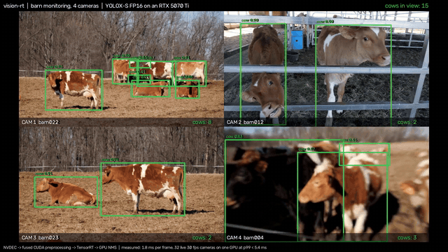
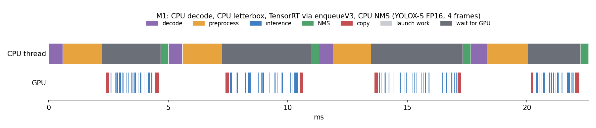
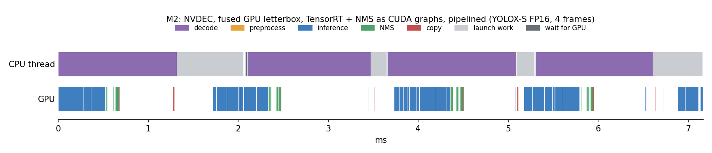
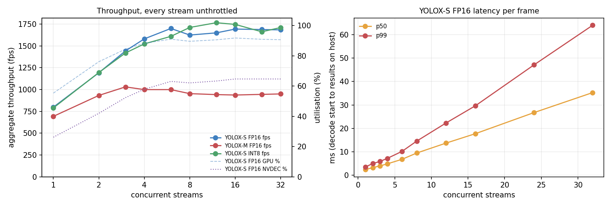
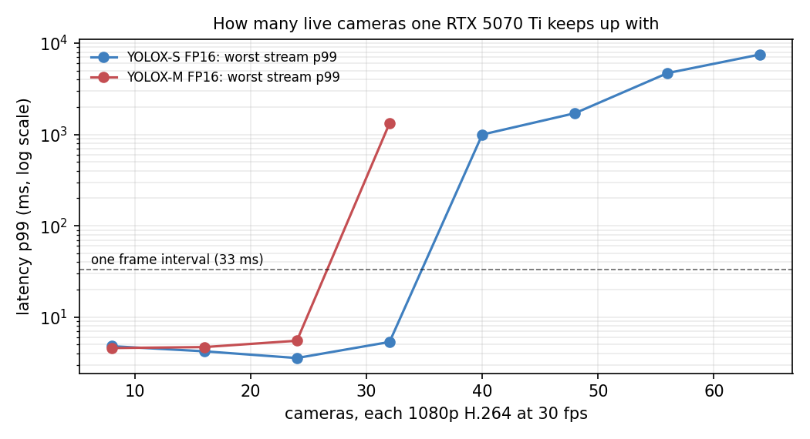
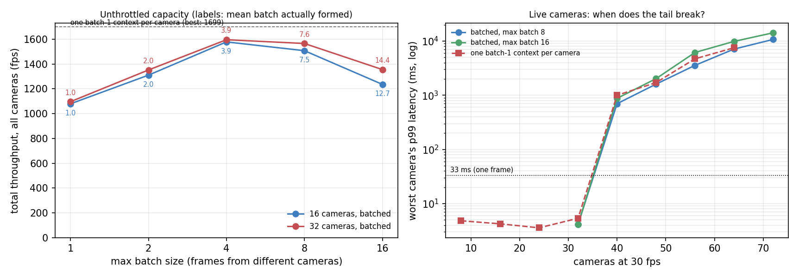
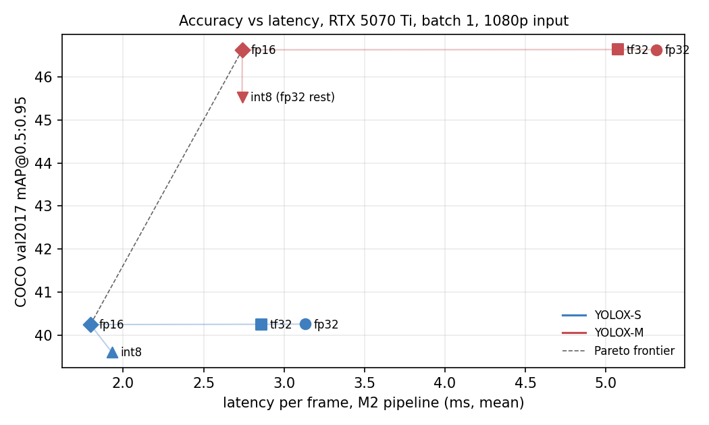

# vision-rt

Real-time object detection on many 1080p camera streams, with every per-frame stage on the GPU:
NVDEC decode, a fused CUDA preprocessing kernel, TensorRT (FP16 / INT8) replayed from CUDA
graphs, and GPU NMS. The scenario is barn monitoring: YOLOX counting cows in public-domain USDA
dairy footage.

On one RTX 5070 Ti, with YOLOX-S FP16 and everything measured end to end, from asking for a
frame to having its detections in host memory:

- **1.8 ms per frame** (p99 2.9 ms), vs 13.7 ms for a naive PyTorch pipeline. **775 fps** on
  one stream with decode overlapped, 10.6x the baseline.
- **32 live 30 fps cameras on one GPU**, every stream's p99 under 5.4 ms.
- **2,264 fps across 32 cameras with cross-camera batching** (up to 8 cameras' frames per
  inference, NMS batched on the GPU), 34% more than one context per camera. Live, it takes 40
  cameras at 30 fps with every stream's p99 under 8.7 ms.
- **0.5 ms of CPU per frame**, down from 49.6 ms.
- Accuracy kept: COCO val2017 mAP 40.25 in FP16 vs 40.26 for the PyTorch model.



The [full 30-second demo](docs/demo.mp4) shows four cameras with the pipeline's own detections:
cows in green and counted, everything else the model reports in grey, mistakes included.

## Results

Every number comes from a file in [`bench/results/`](bench/results) that records its
conditions and versions. Hardware: RTX 5070 Ti (Blackwell, sm_120), WSL2 Ubuntu 24.04, CUDA
13.3, TensorRT 11.3, driver 617.42. YOLOX at 640x640, batch 1 except in the batching section.

### Where the time goes, step by step

<!-- latency:begin -->
| Pipeline | Precision | decode | preprocess | inference | NMS | copies | **latency** mean / p50 / p99 | **fps** | vs M0 | CPU ms/frame |
|---|---|---|---|---|---|---|---|---|---|---|
| M0: PyTorch eager, CPU decode/pre/NMS | fp32-tf32 | 0.98 | 1.24 | 9.74 | 0.56 | 0.80 | **13.73** / 10.67 / 34.62 | **73** | 1.0x | 49.6 |
| M1: C++ + TensorRT, CPU decode/pre/NMS | fp16 | 0.56 | 1.60 | 2.80 | 0.32 | 0.50 | **6.02** / 5.06 / 9.51 | **166** | 2.3x | 10.3 |
| M1 + CUDA graph for the engine | fp16 | 0.56 | 1.59 | 0.60 | 0.33 | 0.51 | **3.71** / 3.64 / 4.62 | **270** | 3.7x | 7.6 |
| M2: NVDEC + GPU pre/NMS, one frame at a time | fp16 | 0.97 | 0.03 | 0.59 | 0.15 | 0.01 | **1.80** / 1.75 / 2.93 | **548** | 7.5x | 1.1 |
| M2, decode overlapped with GPU work | fp16 | 1.04 | 0.04 | 0.59 | 0.16 | 0.01 | **2.55** / 2.51 / 4.00 | **775** | 10.6x | 0.5 |

Mean ms per frame on `barn022.mp4` (1920x1080 H.264), batch 1, one stream, 1406 timed frames after 100 warm-up. CPU stages are host wall-clock; GPU stages (inference everywhere, and preprocess/NMS/copies in M2) are CUDA event times. Latency is from asking for a frame to having its detections in host memory. In the pipelined run stages overlap, so they don't add up to latency, and latency includes waiting behind the next frame's decode. CPU ms/frame is process CPU time (all threads) over the timed frames.
<!-- latency:end -->




Four frames of each pipeline, drawn from Nsight Systems traces
([`bench/profile_timelines.sh`](bench/profile_timelines.sh)). In M1 the CPU thread never stops:
decode, letterbox, then waiting while ~160 kernels are launched one at a time, then NMS. In M2
the CPU decodes on NVDEC and queues work, and the GPU runs each frame as one dense block (graph
replay, NMS, a tiny result copy) and is idle about half the time. Multiple cameras use that
headroom.

How each step earned its gain:

- **TensorRT + C++ (2.3x).** Eager PyTorch launches 451 kernels per YOLOX-S forward pass and
  keeps the GPU busy only a third of the time
  ([`eager_profile_yolox_s.json`](bench/results/eager_profile_yolox_s.json)). The TensorRT FP16
  engine does the same work in 0.57 ms and costs 0.01 mAP.
- **CUDA graph for the engine (1.6x).** Nsight showed `enqueueV3` spending 1.6 ms of CPU per
  frame issuing launches through WSL's driver. Replaying a captured graph brings inference to
  0.59 ms, matching trtexec, with identical detections.
- **Frames stay on the GPU (2.1x).** NVDEC decodes into GPU memory, one fused kernel turns
  NV12 into the FP16 input tensor in ~0.03 ms (vs 1.6 ms of CPU letterbox), and NMS runs on the
  GPU. Only ~2.4 KB of detections cross PCIe per frame.
- **Decode overlapped with GPU work (1.4x throughput)** at the cost of ~0.75 ms latency.
  Throughput is then capped by NVDEC.

Correctness is checked before speed. Every variant's detections are compared frame by frame
with the baseline's ([`compare_*.json`](bench/results)): the C++/TensorRT path matches on
99.98-100% of boxes, and the GPU path on 99.8% (mean IoU 0.993). The remaining difference is
colour conversion: the kernel uses exact BT.709, while OpenCV's fast path rounds about a level
dark. The preprocessing kernel and GPU NMS are bit-identical to the C++ reference in the tests.

### Many cameras on one GPU



With every stream running flat out, YOLOX-S tops out at **~1,700 fps total** from 6 streams
on. The GPU is ~91% busy there and NVDEC ~65%, so the limit is GPU compute. Past the knee,
throughput stays flat and latency grows linearly with the number of streams: queueing.
Concurrent streams overlap each other's kernels, so the total beats the ~1,300 fps that one
stream's 0.77 ms of GPU work would allow. YOLOX-M saturates the GPU at 3 streams (~1,000 fps).



Paced like real cameras (30 fps each, unsynchronised, one frame at a time), the GPU runs **32
cameras with YOLOX-S at p99 under 5.4 ms** for every stream, or 24 with YOLOX-M. At 40
cameras YOLOX-S demand reaches ~83% of what the GPU serves frame by frame (~1,450 fps). The
median is still 2.7 ms, but p99 jumps to ~0.7 s.

### Batching frames across cameras



[`vrt_batched`](apps/vrt_batched.cpp) puts every camera's decoded frames in one queue. A batcher
thread takes up to *B* of them, letterboxes each into its slot of one input tensor, and runs the
smallest static-batch engine (1/2/4/8/16) that fits. Then batched NMS runs once for the whole
batch, and one copy brings every image's detections back.

| YOLOX-S FP16, 32 cameras flat out | max batch 1 | 4 | 8 | 16 | one context per camera |
|---|---|---|---|---|---|
| mean batch formed | 1.0 | 3.9 | 7.6 | 14.5 | 1 |
| engine time per image | 0.62 ms | 0.38 ms | 0.36 ms | 0.39 ms | 0.60 ms (same engine) |
| NMS time per image | 0.15 ms | 0.022 ms | 0.015 ms | 0.014 ms | 0.15 ms |
| total throughput | 1,127 fps | 2,161 fps | **2,264 fps** | 1,714 fps | **1,684 fps** |
| worst camera's p99 | 57 ms | 30 ms | 34 ms | 43 ms | 68 ms |
| GPU / NVDEC busy (NVML) | 79% / 40% | 84% / 75% | 83% / 82% | 68% / 66% | 91% / 65% |

At max batch 8, batching does 2,264 fps on 32 cameras: 34% more than one batch-1 context per
camera, with half the tail latency. The first version reached 1,596 fps, short of per-camera
contexts, because only the engine was batched. NMS still ran per image, as parallel branches of
a CUDA graph, and it got *more* expensive per image as batches grew. What changed:

- **Batched NMS** ([`postprocess.cu`](src/kernels/postprocess.cu), `GpuBatchPostprocess`). One
  score kernel covers all of `[B, 8400, 85]`. One CUB radix sort then covers all B x 8400
  anchors, because the image index sits in the top bits of a 56-bit key: inverted image,
  score, inverted anchor. Each image's candidates come out together, in the same order the
  per-image sort gives. One mask kernel and one walk kernel, with a block per image, finish the
  job. NMS costs 0.015 ms per image at batch 8, against 0.15 ms for one image on its own.
  Results are bit-identical to the per-image kernels, which
  [`test_gpu_kernels.py`](tests/test_gpu_kernels.py) checks for batches of 1-16, including
  empty images, exact score ties and duplicate images. At max batch 1, `vrt_batched` reproduces
  the unbatched GPU path's detections on barn022 exactly
  ([`compare_batched_b1_barn022.json`](bench/results/compare_batched_b1_barn022.json)).
  Larger batches use other engines with their own FP16 tactics. They match on 99.94% of boxes,
  mean IoU 0.998 ([`compare_batched_b4_barn022.json`](bench/results/compare_batched_b4_barn022.json)).
- **Two batches in flight** (`--in-flight 2`, the default) queues batch n+1 before the host
  waits on batch n. It makes no measurable difference: 2,264 fps vs 2,303 with one in flight in
  the run above, and 2,263 vs 2,258 averaged over three sweeps. Once NMS is batched, the batch
  stream is 93-95% occupied either way. The host's turnaround between batches was never the gap.

What limits it now is decode, more than compute. Across every run, NVDEC load tracks throughput
at about 35-39% per 1,000 fps. That puts the decoders' ceiling at roughly 2,600-2,900 fps, and
max batch 8 already runs them at 82%. The engine stops getting cheaper per image after batch 4.
Max batch 16 falls back to 1,714 fps, with both GPU and NVDEC at ~67%. In its batches, the
preprocess span (which includes waiting for each frame's decode-side ready event) grows from
0.04 to 0.15 ms per image. The batcher is waiting for frames, not computing.

With live cameras, batching now moves the knee. Unsynchronised 30 fps cameras arrive one at a
time, and the batcher doesn't wait, so batches stay around 1.1 frames. But when a burst builds
a queue, the next batch is bigger and cheaper per frame, so the queue drains. With max batch 8,
40 cameras run at worst p99 8.7 ms, where per-camera contexts are at 998 ms. The knee moves from
32-40 cameras to 40-48. Waiting a few ms to fill batches would trade latency for throughput that
these loads don't need.

Building this turned up a crash in about one run in twenty. A CUDA graph was being captured
lazily while other threads decoded, which sometimes invalidated the capture. The error path then
corrupted a frame-slot counter, and a frame was written to `frames[-1]`. The fix was to capture
every graph before any worker thread starts, in both the batched and the per-camera apps.

### Accuracy vs latency



FP16 is the frontier for both model sizes. TF32 and FP32 add latency for no accuracy. INT8
(post-training, explicit Q/DQ with TensorRT Model Optimizer, entropy calibration on COCO
*train* images) costs YOLOX-S 0.64 mAP and gains nothing end to end. At batch 1 the engine is
only 6% faster, and the pipeline is decode-bound anyway. YOLOX-M with INT8 + FP16 gives wrong
output on TensorRT 11.3; the bisection and everything ruled out are in
[`int8_yolox_m_investigation.json`](bench/results/int8_yolox_m_investigation.json).

<!-- m2:begin -->
| Model | Precision | mAP (TensorRT) | M2 sync latency mean / p99 | M2 sync fps | M2 pipelined fps | GPU time per frame | vs M0 (fps) |
|---|---|---|---|---|---|---|---|
| YOLOX-S | fp32 | 40.26 | 3.13 / 4.35 ms | 317 | 480 | 1.98 ms | 6.6x |
| YOLOX-S | tf32 | 40.26 | 2.86 / 4.01 ms | 346 | 583 | 1.62 ms | 8.0x |
| YOLOX-S | fp16 | 40.25 | 1.80 / 2.93 ms | 548 | 775 | 0.77 ms | 10.6x |
| YOLOX-S | int8 (entropy) | 39.61 | 1.93 / 3.14 ms | 511 | 776 | 0.75 ms | 10.7x |
| YOLOX-M | fp32 | 46.63 | 5.32 / 6.50 ms | 187 | 244 | 4.06 ms | 4.0x |
| YOLOX-M | tf32 | 46.63 | 5.07 / 6.36 ms | 196 | 258 | 3.63 ms | 4.2x |
| YOLOX-M | fp16 | 46.63 | 2.74 / 3.95 ms | 361 | 645 | 1.43 ms | 10.5x |
| YOLOX-M | int8, fp32 elsewhere | 45.54 | 2.74 / 3.85 ms | 361 | 624 | 1.47 ms | 10.2x |
<!-- m2:end -->

<!-- accuracy:begin -->
| Model | Precision | mAP, PyTorch | mAP, TensorRT | mAP, C++ app | TensorRT GPU compute (model only) |
|---|---|---|---|---|---|
| YOLOX-S | fp32 | 40.26 | 40.26 | 40.23 | 1.82 ms |
| YOLOX-S | tf32 | 40.26 | 40.26 | — | 1.48 ms |
| YOLOX-S | fp16 | — | 40.25 | 40.24 | 0.57 ms |
| YOLOX-S | int8 (entropy) | — | 39.61 | — | 0.54 ms |
| YOLOX-S | int8 (max calib.) | — | 38.57 | — | 0.56 ms |
| YOLOX-M | fp32 | 46.63 | 46.63 | — | 3.90 ms |
| YOLOX-M | tf32 | 46.64 | 46.63 | — | 3.49 ms |
| YOLOX-M | fp16 | — | 46.63 | 46.65 | 1.25 ms |
| YOLOX-M | int8 (entropy) ⚠ | — | 18.29 | — | 1.04 ms |
| YOLOX-M | int8, fp32 elsewhere | — | 45.54 | — | 1.25 ms |

COCO val2017 mAP@0.5:0.95, all 5,000 images, score threshold 0.01, NMS IoU 0.65. "C++ app" runs the whole C++ path, including its own FFmpeg JPEG decode. The last column is trtexec's mean GPU time for the engine alone at batch 1: no decode, no pre/postprocessing, no copies. It is not an end-to-end number. INT8 is post-training quantization with explicit Q/DQ (Model Optimizer, entropy or max calibration on 512 COCO train images). ⚠ YOLOX-M with INT8 + FP16 gives wrong output on TensorRT 11.3; keeping the non-quantized layers in FP32 restores accuracy but is no faster than plain FP16, so YOLOX-M deploys as FP16.
<!-- accuracy:end -->

The published YOLOX numbers are 40.5 / 46.9. At score threshold 0.001 instead of 0.01 this
pipeline gives 40.45 for YOLOX-S, so the gap is the threshold, not the pipeline.

### TensorRT's NMS layer vs my GPU NMS

TensorRT 11 replaced the EfficientNMS plugin with a built-in NMS layer. I appended ONNX
NonMaxSuppression to the graph ([`tools/add_nms.py`](tools/add_nms.py)) and ran it against my
NMS on the same raw predictions over COCO val
([`tools/compare_nms_layer.py`](tools/compare_nms_layer.py)). mAP is identical (40.248), and the
boxes are identical on 4,991 of 5,000 images at deploy thresholds. But the layer's output size
is data-dependent, so inference syncs with the host mid-run and the engine can't be captured
as a CUDA graph. It adds ~0.46 ms per frame on real images, and in trtexec the engine goes
from 0.57 to ~2.5 ms. My kernels write a fixed-size result block and take ~0.15 ms.

## Architecture

```
 camera / file ──► NVDEC (FFmpeg hwaccel, frames stay in GPU memory as NV12)
                     │   one CUDA stream per camera; FFmpeg's surface copy is queued on it
                     ▼
               fused preprocess kernel   NV12 → BGR (BT.709) → bilinear letterbox → pad
                     │                   → planar CHW → FP16, in one pass (~0.03 ms)
                     ▼
               TensorRT engine           replayed from a CUDA graph (~160 launches → 1)
                     │                   output [1, 8400, 85], box decode in FP32
                     ▼
               GPU NMS                   score filter → CUB radix sort on (score, anchor)
                     │                   → bitmask IoU tiles → one-block walk; also a CUDA graph
                     ▼
               pinned result slot        ~2.4 KB per frame; two slots, so frame n+1 decodes
                     │                   while the GPU runs frame n
                     ▼
               detections on the host
```

| Component | Files |
|---|---|
| NVDEC decode | [`src/nvdec_source.cpp`](src/nvdec_source.cpp) |
| Fused preprocessing kernel | [`src/kernels/preprocess.cu`](src/kernels/preprocess.cu) |
| GPU score filter + NMS | [`src/kernels/postprocess.cu`](src/kernels/postprocess.cu) |
| TensorRT engine, contexts, CUDA graphs | [`src/trt_engine.cpp`](src/trt_engine.cpp) |
| Per-camera pipeline (streams, events, pinned slots) | [`src/gpu_pipeline.cpp`](src/gpu_pipeline.cpp) |
| Cross-camera batching (batch engines, batched NMS) | [`src/batch_inference.cpp`](src/batch_inference.cpp), [`apps/vrt_batched.cpp`](apps/vrt_batched.cpp) |
| Apps: single stream, multi-stream, batched, decode bench, COCO | [`apps/`](apps) |
| CPU reference path (M1) and baseline (M0) | [`src/sync_pipeline.cpp`](src/sync_pipeline.cpp), [`tools/baseline.py`](tools/baseline.py) |
| ONNX export, INT8 quantization, NMS-layer variant | [`tools/export_onnx.py`](tools/export_onnx.py), [`tools/quantize_int8.py`](tools/quantize_int8.py), [`tools/add_nms.py`](tools/add_nms.py) |
| Tests: C++ unit, C++ vs Python, CUDA vs C++ | [`tests/`](tests) |

## Build and run

Linux with an NVIDIA GPU (tested on WSL2 Ubuntu 24.04).

| Component | Version |
|---|---|
| CUDA toolkit | 13.3 |
| TensorRT | 11.3.0 (tar install; 11.4 has a known INT8 YOLOX issue on Blackwell) |
| FFmpeg | 8.1, [BtbN](https://github.com/BtbN/FFmpeg-Builds) GPL shared build (NVDEC enabled) |
| PyTorch | 2.14.1 + CUDA 13.0 wheels |
| Python | 3.12 |

```bash
git clone --recurse-submodules https://github.com/mann-uofg/vision-rt.git
cd vision-rt
python3 -m venv ~/venvs/vision-rt
source scripts/env.sh            # TensorRT, FFmpeg, CUDA paths and the venv; edit if yours differ
pip install torch==2.14.1 torchvision==0.29.1 --index-url https://download.pytorch.org/whl/cu130
pip install -r requirements.txt -e .
pip install "$TRT_ROOT"/python/tensorrt-*-cp312-*.whl
pip install -r requirements-int8.txt   # only for INT8 quantization

scripts/fetch_models.sh          # YOLOX-S / YOLOX-M COCO weights, hash-checked
scripts/fetch_coco.sh            # COCO val2017 (~1 GB)
scripts/fetch_footage.sh         # the barn clips, transcoded to 1080p H.264

cmake --preset release && cmake --build --preset release && ctest --preset release
python -m pytest -q
bench/build_engines.sh           # ONNX export + fp32 / tf32 / fp16 engines
```

```bash
build/release/vrt_pipeline --engine models/yolox_s_fp16.engine --video data/footage/barn022.mp4
build/release/vrt_multistream --engine models/yolox_s_fp16.engine --streams 8 \
  --videos data/footage/barn022.mp4,data/footage/barn023.mp4 --fps 30 --mode sync
python tools/eval_coco.py --size s --engine models/yolox_s_fp16.engine   # COCO mAP

bench/run_all.sh                 # decode, baseline and every pipeline variant (idle GPU)
bench/run_multistream.sh         # scaling: unthrottled capacity and 30 fps cameras
SIZES=s PRECISIONS= BATCHES="2 4 8 16" bench/build_engines.sh && bench/run_batched.sh  # batching
bench/profile_timelines.sh       # Nsight traces -> docs/timeline_*.png
python tools/make_calib.py && PRECISIONS=int8 bench/build_engines.sh   # INT8
bench/make_demo.sh               # the demo video
python bench/make_tables.py      # regenerate the tables in this README
```

## Design decisions

- **TensorRT 11.3, strongly typed.** TensorRT 11 removed implicit INT8 calibration and the
  precision builder flags, so precision lives in the ONNX graph: one graph per precision, and
  INT8 as explicit Q/DQ from Model Optimizer. 11.4 was avoided because of a known INT8 YOLOX
  wrong-output issue on Blackwell.
- **YOLOX, not RT-DETR or Ultralytics.** A dense detector that needs NMS (so GPU NMS is part of
  the work), under Apache-2.0.
- **One milestone, one change.** M1 kept the baseline's CPU stages and swapped only the model,
  so each step's gain is attributable. M1's C++ letterbox reproduces the Python input bit for
  bit on the benchmark clip.
- **Box decode in FP32** even in FP16/INT8 graphs: near 640 px, FP16 can only represent every
  0.5 px, and exp() amplifies the error.
- **Fused preprocessing sharing the CPU's tap tables, built without FMA,** so the GPU kernel can
  be tested bit-exactly against the C++ reference.
- **GPU NMS with a fixed-size output** (sort on a (score, anchor) key, bitmask IoU, serial walk
  in one block). No host sync, CUDA-graph capturable, and identical to the CPU reference.
- **One shared engine, one execution context per camera.** Weights are loaded once; each stream
  owns its activations, buffers, graphs and decoder.
- **Measured CPU time and p99, not just mean fps,** because they decide how many cameras one
  machine can take.

## Limitations

- **WSL2.** Kernel launches cost more than on native Linux (that's part of why CUDA graphs
  helped so much), and host-side jitter shows up in the baseline's p99. Not re-measured on
  bare-metal Linux.
- **Batching runs close to the decode limit.** Cross-camera batching reaches 2,264 fps on 32
  cameras with NVDEC at 82%, and decode load rises in step with throughput. Going further takes
  more decode headroom, not bigger batches. Live cameras only get batches of ~1 unless the
  batcher waits.
- **COCO model, no fine-tuning.** Wide barn shots work well; dark close-ups and calves get
  misclassified (dog, sheep, horse), as the demo shows. Fine-tuning on cattle footage would fix
  that. The footage is barn-style, not real fixed-mount barn cameras.
- **INT8 for YOLOX-M is unresolved** on TensorRT 11.3 (wrong output with INT8 + FP16).
- **NVDEC through FFmpeg decodes one frame at a time per stream** (~1.1 ms per 1080p frame). The
  Video Codec SDK directly would allow more decodes in flight.
- **No tracking.** Counts are per frame; ByteTrack-style tracking would give per-cow identity.

## Footage and model licences

- Footage: USDA "Dairy Cows (20220209-FPAC-RockHillDairy…)" on Wikimedia Commons, public
  domain. Downloaded by `scripts/fetch_footage.sh`; only the rendered demo is in the repo.
- Model: [YOLOX](https://github.com/Megvii-BaseDetection/YOLOX) (Apache-2.0), pinned as a
  submodule in `third_party/YOLOX`, with the official COCO checkpoints.
